# Doctor Tracker Frontend

## Description

Doctor Tracker is a responsive clinic administration app for managing doctors and patients in one place. Clinic administrators can review registration trends, search and filter records, assign patients to doctors, and manage records from desktop or mobile devices.

## Setup guide

### Requirements

- Node.js 20 or newer
- The Doctor Tracker API running locally or at a reachable URL

### Install and run locally

1. Install dependencies:

   ```sh
   npm install
   ```

2. Copy `.env.example` to `.env.local` (`Copy-Item .env.example .env.local` in PowerShell).
3. Set `NEXT_PUBLIC_API_URL` in `.env.local` to the API base URL. For a local backend, use:

   ```env
   NEXT_PUBLIC_API_URL=http://localhost:4000/api/v1
   ```

4. Start the development server and open `http://localhost:3000`:

   ```sh
   npm run dev
   ```

The backend must allow `http://localhost:3000` through its `CLIENT_ORIGIN` setting. Its setup instructions are in [Doctor Tracker Backend](../Doctor-Tracker-Backend/README.md).

### Environment variables

| Variable | Description |
| --- | --- |
| `NEXT_PUBLIC_API_URL` | Base URL for the API, including `/api/v1` |

The checked-in `.env.example` is the template for local configuration. Do not put secrets in this public frontend variable.

## System architecture

The browser renders the Next.js App Router UI. TanStack Query fetches and caches data from the independently deployed Express API. The API validates requests, applies authentication from HTTP-only cookies, and reads or updates MongoDB through Prisma. Login and refresh tokens are not stored in browser local storage.

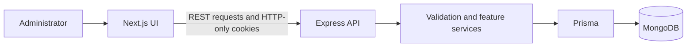

## Technical decisions

1. **Next.js App Router with client-side data queries.** App Router provides route-based pages for the dashboard, doctors, patients, and profiles. TanStack Query handles request caching, loading/error states, and refreshing lists after changes. This keeps API state out of large page components while allowing the app to remain a client-rendered admin workspace.
2. **HTTP-only cookie authentication and a separate API.** The browser sends credentials with API requests, while JavaScript cannot read the authentication cookies. Keeping the frontend and API as separate applications allows independent deployment and scaling. It requires the API URL, CORS origin, and cookie settings to be configured together, especially for production HTTPS deployments.

## Visual evidence

Screenshots below are captures of the running application. Desktop and mobile examples are included for the main workflows.

### Desktop

| Dashboard | Doctors |
| --- | --- |
| 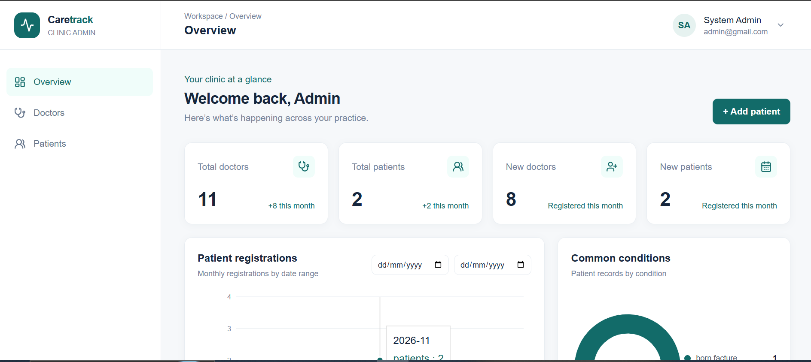 | 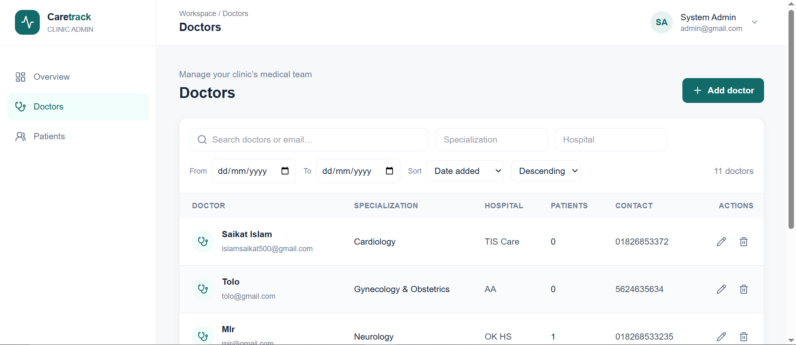 |

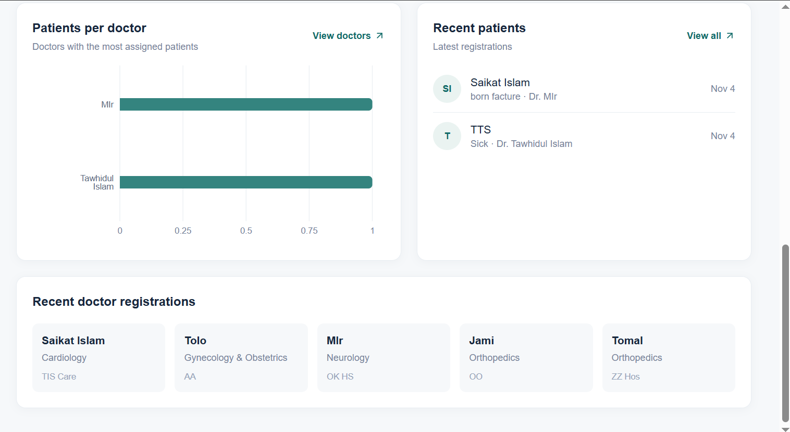

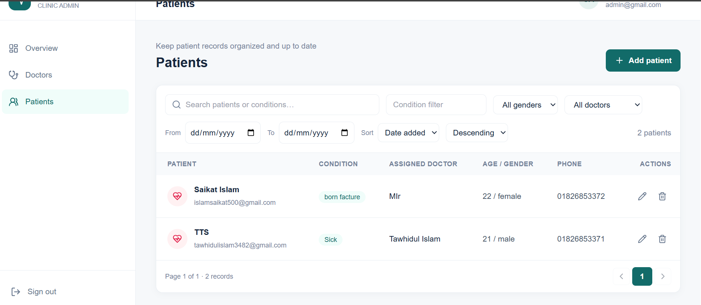

### Mobile

| Dashboard | Doctors |
| --- | --- |
| 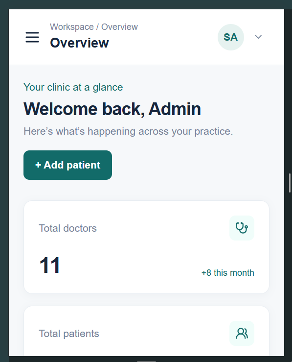 | 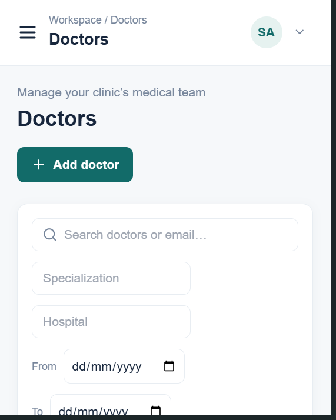 |

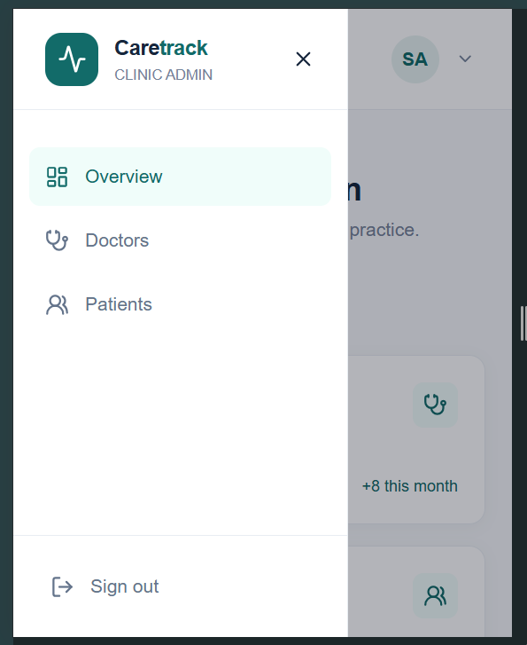

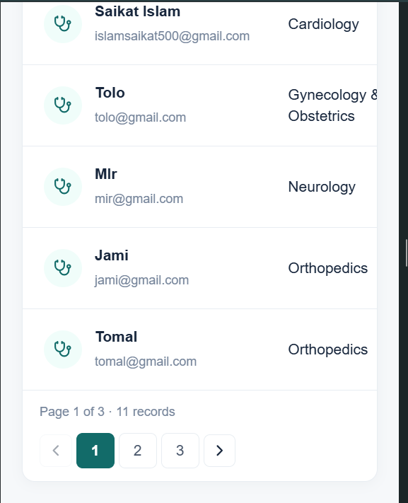

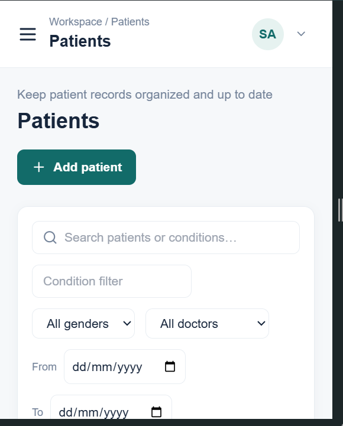

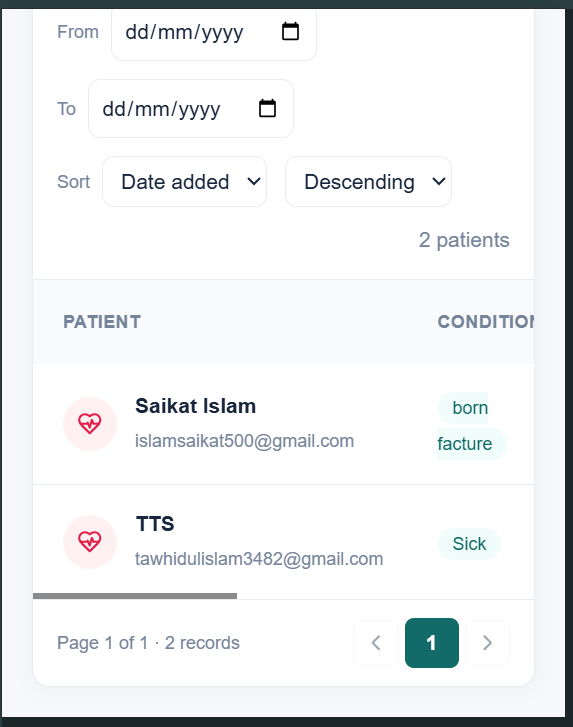

## Scripts

| Command | Action |
| --- | --- |
| `npm run dev` | Start the development server |
| `npm run build` | Create a production build |
| `npm run start` | Serve the production build |
| `npm run lint` | Run ESLint checks |

## Main routes and features

- `/login` — administrator sign-in
- `/` — dashboard totals, charts, and recent records
- `/doctors` — searchable, filterable, sortable doctor list with pagination and record management
- `/doctors/[id]` — doctor profile and assigned patients, with patient add and delete actions
- `/patients` — searchable, filterable, sortable patient list with pagination and record management

The API supplies all doctor and patient records; the frontend does not keep a local database or production data copy.
